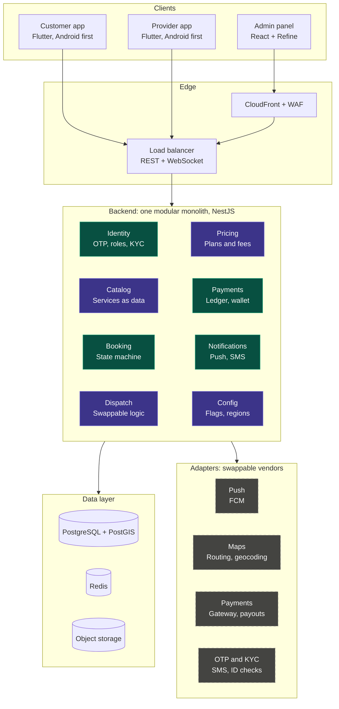
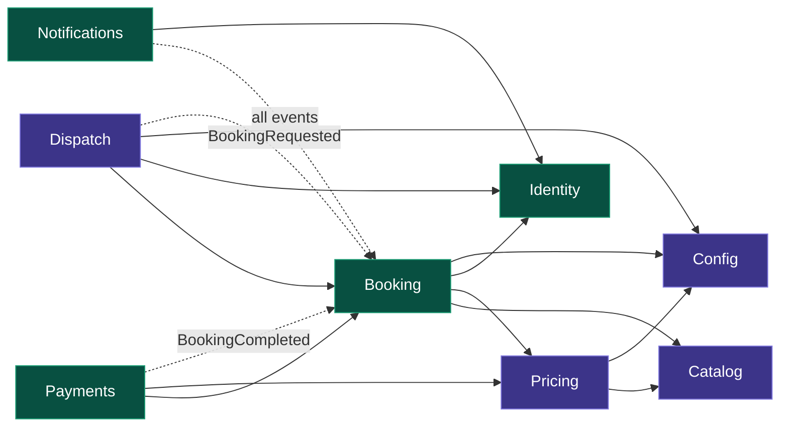
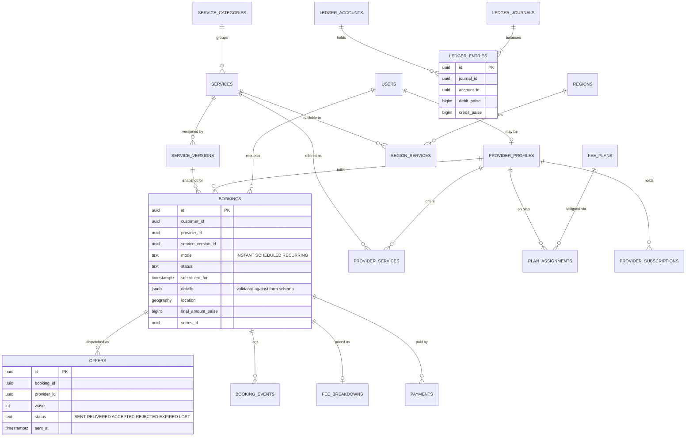
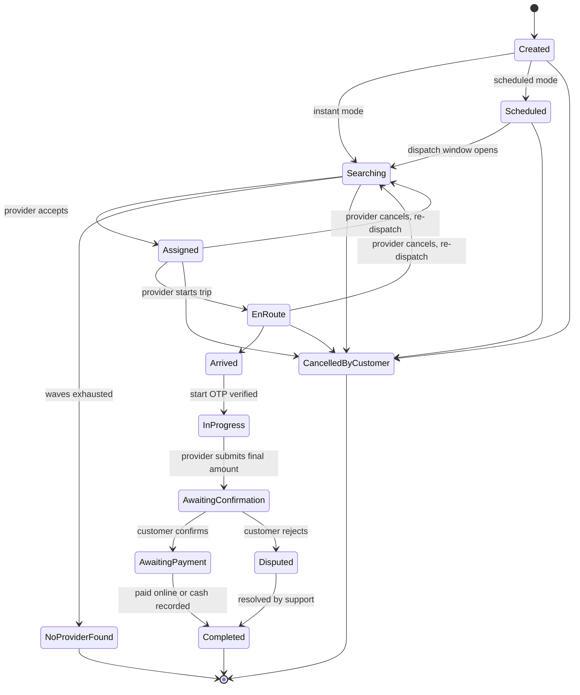
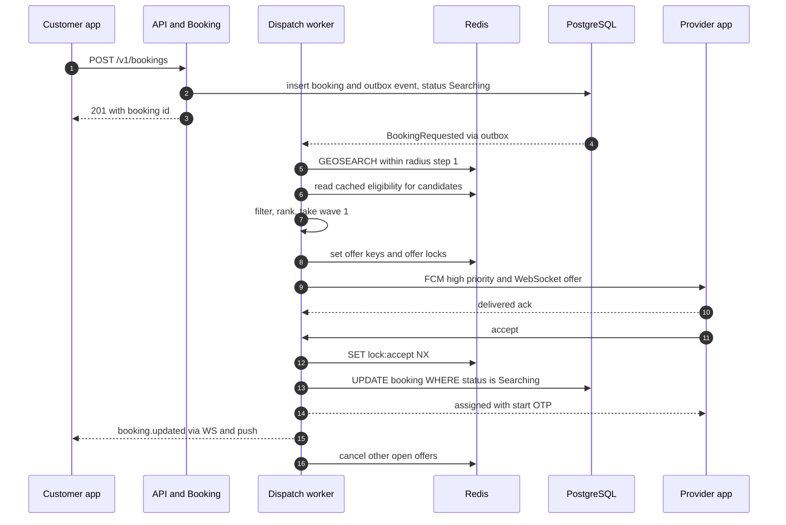
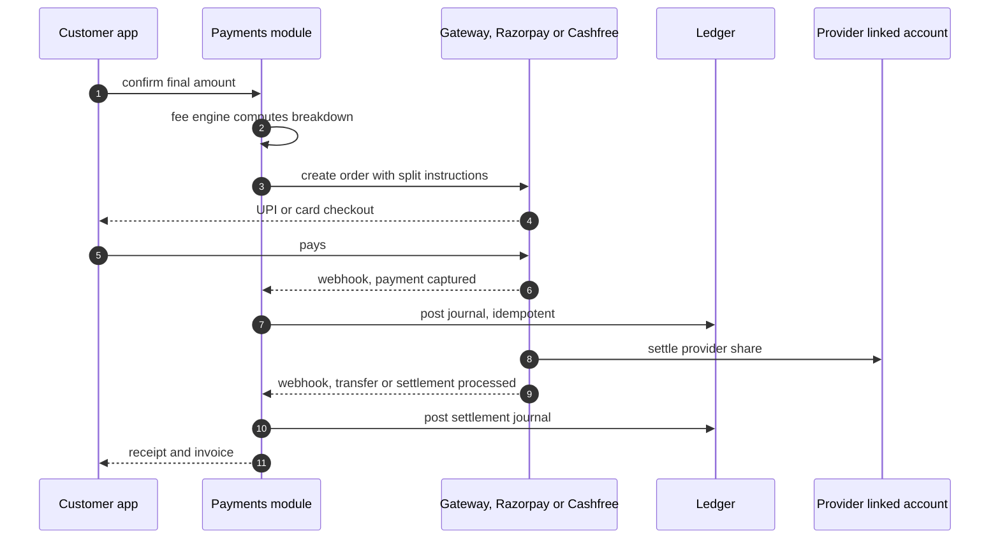

# Home Services Marketplace: System Architecture

> **Version** 1.0 · **Status** Proposed · **Last updated** 3 Nov 2026
> **Scope** India launch (single city, 1–2 services) designed to pivot and scale to multi-city, multi-service.
> **Team assumption** 2–3 developers, lean MVP, managed AWS/GCP containers.

---

## Table of contents

1. [Executive summary](#1-executive-summary)
2. [Goals, constraints and assumptions](#2-goals-constraints-and-assumptions)
3. [Architectural principles](#3-architectural-principles)
4. [System overview](#4-system-overview)
5. [Technology stack](#5-technology-stack)
6. [Backend: the modular monolith](#6-backend-the-modular-monolith)
7. [Data architecture](#7-data-architecture)
8. [Core flows: booking and dispatch](#8-core-flows-booking-and-dispatch)
9. [Money: fee engine, ledger, payments](#9-money-fee-engine-ledger-payments)
10. [Configuration as data](#10-configuration-as-data)
11. [Server-driven UI](#11-server-driven-ui)
12. [Adapters and vendors (India)](#12-adapters-and-vendors-india)
13. [Realtime, push and Android reliability](#13-realtime-push-and-android-reliability)
14. [API design](#14-api-design)
15. [Mobile apps (Flutter)](#15-mobile-apps-flutter)
16. [Admin panel](#16-admin-panel)
17. [Security, privacy and compliance](#17-security-privacy-and-compliance)
18. [Infrastructure and deployment](#18-infrastructure-and-deployment)
19. [Observability and operations](#19-observability-and-operations)
20. [Testing strategy](#20-testing-strategy)
21. [Scaling path](#21-scaling-path)
22. [Build order and roadmap](#22-build-order-and-roadmap)
23. [Risks](#23-risks)
24. [Open decisions](#24-open-decisions)
25. [Appendix: pre-launch checklist](#25-appendix-pre-launch-checklist)

---

## 1. Executive summary

We are building an on-demand home-services marketplace (plumber, electrician, AC repair, house help, and so on) with a **customer app**, a **provider app** and an **admin panel**. The business model is not fixed yet (subscription, commission, hybrid or pay-per-lead), and the service list will change. The architecture is therefore built around one idea:

> **Keep the core stable and push everything that might pivot into data and adapters.**

### Decisions at a glance

| Area | Decision |
|---|---|
| Architecture style | **Modular monolith** (one deployable, hard module boundaries), run as two process roles: `api` and `worker` |
| Backend | **TypeScript + NestJS**, REST + WebSocket, OpenAPI as the contract |
| System of record | **PostgreSQL + PostGIS** (money, bookings, config, geo queries) |
| Live state | **Redis** (provider location index, dispatch locks, offer timeouts, job queues) |
| Mobile | **Flutter**, two apps (customer, provider) in one monorepo with a shared design-system package |
| Realtime | **WebSocket + high-priority FCM** (offers must wake the provider's phone) |
| Admin | **React (Refine)** on the same API, built early because it is the control room |
| Flexibility | Service catalogue, booking forms, pricing, fee plans, dispatch rules and regions are **rows in the database**, managed from admin |
| Vendors | Maps, payments, SMS, KYC, push, masked calling sit behind **adapter interfaces** |
| Money | **Fee engine + immutable double-entry ledger**; online jobs use **gateway split settlement** (Razorpay Route or Cashfree Easy Split); cash jobs accrue **dues** |
| Hosting | **AWS `ap-south-1` (Mumbai)**: ECS Fargate, RDS PostgreSQL, ElastiCache, S3. GCP equivalents in [section 18](#18-infrastructure-and-deployment) |
| Explicitly not at MVP | Microservices, Kubernetes, Kafka, own routing engine, in-app VoIP, ML ranking |

---

## 2. Goals, constraints and assumptions

### Goals

- Launch **one city with one or two services** quickly, then expand without rewrites.
- A **premium-feeling UI** (custom design system, smooth animation) on low-to-mid-range Android phones.
- **Reliable offers**: a provider who is online must actually receive the job, even on aggressive Android OEMs.
- **Pivot-proof monetisation**: switch or mix subscription, commission and pay-per-lead by editing data, not code.
- **Add a service in minutes**: "AC repair" or "cook" is a catalogue entry, not a release.

### Constraints

- 2–3 developers, lean budget, so prefer managed services and boring technology.
- India first: UPI, DLT-regulated SMS, Indian KYC, tax and data-protection rules.
- Android first; iOS later should be cheap.

### Assumptions (change any of these and tell me)

| # | Assumption | Impact if wrong |
|---|---|---|
| A1 | Launch in one city, 1–2 services, instant bookings first | Scheduled/recurring is already modelled, only the UI is deferred |
| A2 | Customers pay by **cash or UPI/cards**; providers can be paid online | If cash-only at launch, skip gateway split until Phase 3 |
| A3 | Monetisation is undecided | Fee engine supports all four plan types from day one |
| A4 | UI languages: **English + Hindi** from day one | Localisation is built into apps and notification templates |
| A5 | Providers must pass KYC before they can go online | Gate is a config flag in dispatch eligibility |
| A6 | iOS comes later | Flutter makes this cheap; provider-app background rules differ on iOS |

### Non-goals for the MVP

Microservices, Kubernetes, event streaming platforms, a self-hosted routing engine, in-app VoIP calling, ML-based ranking, multi-currency, a public API for third parties.

---

## 3. Architectural principles

1. **Stable core, flexible edges.** Identity, Booking, Payments, Notifications rarely change. Catalog, Pricing, Dispatch, Config are where pivots happen.
2. **Configuration as data.** If a product manager could ask to change it, it lives in the database and is editable in admin, with versioning and audit.
3. **Everything vendor-shaped sits behind a port.** Maps, payments, SMS, KYC, push, telephony. Business code never imports a vendor SDK.
4. **Money is append-only.** Fees are computed by a pure, versioned engine. Every movement is an immutable double-entry journal. Corrections are reversing entries, never updates.
5. **Server-driven UI only where change is frequent.** Home sections and per-service booking forms. Live map, offer screen, tracking and payment stay hand-built native screens.
6. **Boring technology, managed hosting.** No component the team cannot operate at 3 a.m.
7. **Postgres is truth, Redis is rebuildable.** Anything in Redis can be reconstructed from Postgres after a restart.
8. **Design for the Android reality.** OEM battery killers, flaky 3G/4G and low-RAM phones are the default, not edge cases.
9. **Measure before scaling.** Metrics, logs and cost-per-booking dashboards ship with the first feature.

---

## 4. System overview

Colour legend (matches the diagram you shared): **purple** = configurable pivot points, **teal** = stable core, **dashed grey** = swappable vendors.



### How a request travels

1. Apps talk REST for commands and queries, and one authenticated WebSocket for live events (offers, status changes, tracking).
2. The `api` process serves REST and WebSocket. The `worker` process (same image, different `APP_ROLE`) runs queues, timers, schedulers and reconcilers.
3. Modules talk to each other through **public interfaces and domain events** only. No module reads another module's tables.
4. Vendors are reached through **ports**. Swapping a vendor means writing one adapter and flipping a config row.

---

## 5. Technology stack

| Layer | Pick | Why |
|---|---|---|
| Android apps | **Flutter**, `apps/customer` + `apps/provider` in one monorepo (Melos), shared `design_system` package | Full control of custom UI and animation; iOS later is cheap |
| State, routing | Riverpod, go_router, freezed/json_serializable | Testable, boring, well documented |
| Backend | **TypeScript + NestJS** | Typed modules map to monolith boundaries, big hiring pool, OpenAPI generation |
| DB access | Drizzle ORM (or Kysely) with SQL migrations; raw SQL for PostGIS and ledger | Prisma has awkward PostGIS support; ledger and geo want explicit SQL |
| Database | **PostgreSQL 16+ with PostGIS** | Relational integrity for money, JSONB for flexible attributes, geo queries |
| Live state and queues | **Redis** (ElastiCache) + **BullMQ** | Location index, locks, timeouts, delayed jobs, one dependency |
| Realtime | Native WebSocket (NestJS gateway) + Redis pub/sub fan-out + **FCM high-priority** | Offers must wake the phone; WS covers foreground |
| Admin | **React + Refine** (shadcn/ui or Ant Design), generated API client | Fast CRUD for config, build early |
| Contract | **OpenAPI 3** generated from NestJS; Dart and TS clients generated from it | Apps and admin never hand-write API calls |
| Mock server | Prism or Mockoon from the OpenAPI file | Design and app work never wait on backend |
| Observability | OpenTelemetry, Sentry (backend + Flutter), Firebase Crashlytics, CloudWatch | Cheap, enough for MVP |
| Infra as code | Terraform (portable across AWS/GCP) | One declarative source of truth |
| CI/CD | GitHub Actions with OIDC to AWS, Fastlane or Codemagic for app builds | Minimal moving parts |

---

## 6. Backend: the modular monolith

### 6.1 Module map

| Module | Type | Owns (tables / state) | Public interface (examples) | Emits events |
|---|---|---|---|---|
| **Identity** | Stable | users, devices, sessions, provider_profiles, kyc_records | `getUser`, `isProviderEligible`, `getDeviceTokens` | `UserRegistered`, `ProviderKycApproved`, `ProviderSuspended` |
| **Catalog** | Pivot | categories, services, service_versions (form schema), region_services | `getService`, `getFormSchema(version)` | `ServicePublished` |
| **Booking** | Stable | bookings, booking_events, booking_series, offers (summary) | `createBooking`, `assignProvider`, `transition` | `BookingRequested`, `BookingAssigned`, `JobStarted`, `BookingCompleted`, `BookingCancelled` |
| **Dispatch** | Pivot | dispatch_profiles, offers, provider presence (Redis), provider_stats | `startDispatch`, `acceptOffer`, `rejectOffer` | `OfferSent`, `OfferExpired`, `NoProviderFound` |
| **Pricing** | Pivot | fee_plans, plan_assignments, price_rules, fee_breakdowns | `quote`, `computeFees` (pure) | `FeePlanChanged` |
| **Payments** | Stable | ledger_accounts, ledger_journals, ledger_entries, payments, payouts, provider_subscriptions | `postJournal`, `createPaymentOrder`, `getWalletBalance` | `PaymentCaptured`, `DuesCapReached`, `SubscriptionLapsed` |
| **Notifications** | Stable | templates (per locale), notification_log | `send(userId, template, data)` | none |
| **Config** | Pivot | regions, feature_flags, app_config, home_layouts | `getRegionConfig`, `isEnabled(flag)` | `ConfigChanged` |

**Later modules** (same rules apply): Reviews and ratings, Chat, Support/disputes, Referrals and promotions.

### 6.2 Boundary rules (enforced in CI)

1. A module exposes **only** `index.ts` (its public interface and event types). Deep imports across modules fail lint (`dependency-cruiser` or `eslint-plugin-boundaries`).
2. **One Postgres schema per module** (`identity`, `catalog`, `booking`, ...). Foreign keys exist **inside** a schema. Across modules, store the other module's ID as a plain `uuid` and validate it in the application layer. This keeps extraction possible later.
3. Cross-module reads go through the interface, or through a read model built from events.
4. Side effects (notifications, dispatch start, ledger postings) are triggered by **domain events**, not direct calls from Booking.
5. **Ledger writes only through `Payments.postJournal`.** Nothing else touches ledger tables.

### 6.3 Dependency direction

Solid arrow: "may call the public interface of". Dashed arrow: "reacts to events from".



Booking never calls Dispatch. It emits `BookingRequested`; Dispatch reacts, then calls `Booking.assignProvider` through the interface. There are no call cycles.

### 6.4 Events and the transactional outbox

- In-process typed event bus for synchronous, same-transaction work.
- For anything that must not be lost (notifications, ledger postings, dispatch start), write the event to an **`outbox` table in the same DB transaction** as the state change. A worker relays outbox rows to BullMQ queues.
- Delivery is **at-least-once**; every consumer is **idempotent** (dedupe on `event_id`).
- Webhooks from vendors are stored raw first, then processed from a queue (replayable).

### 6.5 Repository layout

```text
repo/
├─ apps/
│  ├─ customer_app/            # Flutter
│  ├─ provider_app/            # Flutter
│  ├─ admin/                   # React + Refine
│  └─ api/                     # NestJS (api + worker roles)
│     └─ src/
│        ├─ main.ts            # APP_ROLE=api | worker
│        ├─ modules/
│        │  ├─ identity/  catalog/  booking/  dispatch/
│        │  ├─ pricing/   payments/ notifications/ config/
│        │  └─ <module>/{domain,application,infra,http,index.ts}
│        ├─ adapters/          # maps/ payments/ sms/ kyc/ push/ telephony/ storage/
│        └─ shared/            # outbox, event bus, idempotency, errors, logging
├─ packages/
│  ├─ design_system/           # Flutter: tokens, components, motion
│  ├─ api_client/              # generated Dart client
│  ├─ sdui/                    # Flutter: server-driven UI renderer
│  ├─ core/                    # auth, networking, storage, i18n, realtime client
│  ├─ maps_adapter/            # Flutter map widget abstraction
│  └─ admin_api_client/        # generated TS client
├─ contracts/openapi.yaml      # source of truth, generated + reviewed
├─ infra/terraform/            # AWS (and GCP variant)
├─ tools/mock-server/          # Prism/Mockoon + WS mock
└─ docs/adr/                   # architecture decision records
```

### 6.6 One image, two roles

| Role | Runs | Scale on |
|---|---|---|
| `api` | REST, WebSocket gateway, webhook ingress | CPU, WS connections |
| `worker` | BullMQ processors (dispatch timers, notifications, outbox relay, schedulers, reconciliation) | Queue depth |

Splitting roles from day one means the later extraction of the WebSocket gateway or Dispatch workers is a deployment change, not a rewrite.

---

## 7. Data architecture

### 7.1 Conventions

- **IDs**: UUIDv7 (time-ordered, good index locality).
- **Money**: integer **paise** (`bigint`), never floats. Currency column present from day one (`INR`).
- **Time**: `timestamptz` in UTC; region timezone in config.
- **Auditing**: `created_at`, `updated_at`, `version` (optimistic locking) on mutable rows.
- **Immutability**: ledger tables are append-only (revoke `UPDATE/DELETE`, plus a trigger as a belt-and-braces guard).
- **Config versioning**: every config row that affects pricing or forms is versioned, and bookings store the version they were created under.

### 7.2 Core entity model



### 7.3 PostGIS usage

- `provider_locations_latest(provider_id, geography(Point,4326), heading, accuracy, updated_at)` for durable last-known position.
- `provider_location_trail` partitioned by day, sampled during active jobs for dispute evidence and ETA analytics. **Retention 30–90 days** (config), then dropped.
- `region_service_areas` as `geography(MultiPolygon)` so "is this address serviceable" is one query.
- GiST indexes on all geography columns.
- Hot-path candidate search does **not** hit Postgres (see Redis below). Postgres is the fallback and the analytics source.

### 7.4 Redis key design

Everything here is rebuildable from Postgres. On Redis restart, providers re-heartbeat within seconds and a worker re-hydrates open dispatches from `bookings WHERE status = 'SEARCHING'`.

| Key pattern | Type | Purpose | TTL |
|---|---|---|---|
| `geo:online:{regionId}` | GEO | Positions of online, available providers | stale members swept by worker |
| `presence:{providerId}` | string | Heartbeat. Missing means offline or stale | 45–60 s |
| `elig:{providerId}` | hash | Cached eligibility: skills, KYC ok, subscription active, dues ok, rating, tier | refreshed on change events |
| `dispatch:{bookingId}` | hash | Wave number, candidate list, deadline | until resolved |
| `offer:{bookingId}:{providerId}` | string | Marks an open offer | offer TTL (20–30 s) |
| `lock:accept:{bookingId}` | string | **Winner lock**, `SET NX EX` | 10 min |
| `offerlock:{providerId}` | string | One open offer per provider at a time | offer TTL |
| `ws:conn:{userId}` | hash | Which API task holds the user's socket | connection life |
| `cfg:{regionId}:{version}` | string | Cached resolved config | invalidated via pub/sub |
| `otp:{phoneHash}` | hash | Hashed OTP, attempts, cooldown | 5 min |
| `rl:*` | counters | Rate limits | window |
| BullMQ queues | lists/streams | `dispatch-timers`, `notifications`, `outbox`, `scheduler`, `reconcile`, `webhooks` | n/a |

### 7.5 Object storage layout (S3, private, SSE-KMS)

```text
s3://<env>-kyc/{providerId}/...          # KYC documents, selfies (restricted IAM, short retention rules)
s3://<env>-job-media/{bookingId}/...     # before/after photos
s3://<env>-public-assets/...             # catalogue icons, banners (served via CloudFront)
```

Uploads use **pre-signed URLs** straight from the app. The API stores only keys and metadata.

---

## 8. Core flows: booking and dispatch

### 8.1 Booking lifecycle (state machine)

Booking supports **instant, scheduled and recurring** modes from day one, even if you launch instant-only.



**Rules**

- Every transition is a single function `transition(bookingId, event, actor)` that checks the guard, writes `booking_events`, updates status with optimistic locking, and writes outbox events, all in one transaction.
- **Cancellation policy** (free window, fee after provider is en route, provider penalties) is config, evaluated by Pricing.
- **Scheduled**: worker enqueues dispatch at `scheduled_for - lead_time` (lead time per service in config). Optional `preferred_provider_id` is tried first, then falls back to normal dispatch.
- **Recurring**: a `booking_series` row holds an RRULE; a scheduler materialises the next child booking N days ahead.
- **Start OTP**: generated at assignment, shown to the customer, entered by the provider to start the job. Optional end-of-job OTP is a flag.
- **Pricing modes** (per service version): `FIXED`, `VISIT_PLUS_ACTUAL`, `HOURLY`, `QUOTE`. The provider enters the final amount, the customer confirms, then fees are computed.

### 8.2 Dispatch



**Algorithm**

1. **Candidates**: `GEOSEARCH` on `geo:online:{region}` within the current radius step.
2. **Eligibility filter** (from the cached `elig:{id}` hash, no DB on the hot path): online and fresh heartbeat, has the skill, KYC approved, subscription active *if the plan requires it*, dues below cap, not already holding an open offer, not on another active job (configurable), rating above the service minimum.
3. **Rank** by a weighted score from the dispatch profile: ETA/distance, rating, acceptance rate, completion rate, fairness (time since last job), optional tier boost.
4. **Offer in waves**: wave 1 = top N (often 1–3), TTL 20–30 s. If nobody accepts, wave 2 widens the radius, and so on until `maxWaves`.
5. **Delivery ack**: the app acks receipt. If no ack arrives within ~5 s, the system skips ahead instead of waiting for the full TTL.
6. **First accept wins**, enforced twice:
   - Redis `SET lock:accept:{bookingId} {providerId} NX EX 600` (fast, atomic).
   - Postgres compare-and-set `UPDATE bookings SET status='ASSIGNED', provider_id=$p WHERE id=$b AND status='SEARCHING'`. **Postgres is the truth**: if the CAS fails, release the Redis lock and tell the provider the job is gone.
7. **Timers are durable**: wave deadlines are BullMQ delayed jobs, not in-memory `setTimeout`, so a deploy or crash mid-dispatch loses nothing.
8. Every offer is recorded in `offers` for analytics, fairness and disputes.

**Dispatch profile** (data, per service and region):

```json
{
  "id": "dp_emergency_default",
  "appliesTo": { "serviceIds": ["svc_plumber", "svc_electrician"], "regionId": "reg_demo_city" },
  "radiusStepsMeters": [3000, 5000, 8000],
  "waveSize": [2, 3, 5],
  "offerTtlSeconds": 25,
  "deliveryAckSeconds": 5,
  "maxWaves": 3,
  "oneOpenOfferPerProvider": true,
  "eligibility": {
    "requireKyc": true,
    "requireActiveSubscription": "FROM_PLAN",
    "maxDuesPaise": 100000,
    "minRating": 3.5
  },
  "ranking": { "eta": 0.45, "rating": 0.20, "acceptanceRate": 0.15, "fairness": 0.15, "tierBoost": 0.05 },
  "onNoProvider": "NOTIFY_CUSTOMER_AND_ALERT_OPS"
}
```

### 8.3 Provider presence and location

| State | Update interval | Notes |
|---|---|---|
| Online, idle | every 15–30 s or on 50 m movement | Heartbeat doubles as location |
| On an active job (en route) | every 3–5 s | Feeds customer tracking |
| Offline or stale | none | `presence:{id}` expires, provider drops out of the index |

- Location goes over the **WebSocket** in small batches, with HTTP fallback.
- The app queues points in local SQLite when offline and flushes on reconnect.
- Server rejects obviously spoofed data: mock-location flag from the OS, impossible speed jumps, low accuracy. Play Integrity is checked at login and on going online.
- A worker sweeps stale members from the geo index and flags "online but silent" providers for a nudge push.

### 8.4 Live tracking

- The customer app subscribes to `tracking.position` for the booking. The server relays the provider's latest position (throttled, ~every 3–5 s).
- ETA comes from the Maps adapter, **cached and recomputed only every 30–60 s or on route deviation**, to control map-API cost.
- If the WebSocket drops, the app falls back to polling `GET /v1/bookings/{id}/tracking`.

---

## 9. Money: fee engine, ledger, payments

Money is the most delicate part of the system. The rule: **fees are computed by a pure function, and every movement is an immutable journal.**

### 9.1 Plan types are data

| Plan type | Provider pays | When it is charged | Dispatch effect |
|---|---|---|---|
| `SUBSCRIPTION` | Fixed fee per period (weekly, monthly) | On purchase or renewal | Lapsed subscription **stops offers** |
| `COMMISSION` | % of job value (with min/max) | On job completion | Dues cap can pause dispatch |
| `HYBRID` | Smaller subscription plus lower commission | Both | Both rules apply |
| `PAY_PER_LEAD` | Fixed fee per accepted lead | On accept (from prepaid credits) | Zero credits means no offers |

A plan is assigned to a provider by `(provider, service, region, effective_from)`. Admin can move providers between plans or run different plans per city.

### 9.2 Fee engine

```ts
// Pure and deterministic: same input always gives the same output. No I/O.
computeFees(input: {
  plan: FeePlanVersion;            // snapshot, versioned
  job: { finalAmountPaise: number; labourPaise: number; materialsPaise: number; paymentMode: 'ONLINE' | 'CASH' };
  context: { regionId: string; providerTier?: string; promoCredits?: number };
}): FeeBreakdown;                  // commission, taxes, provider net, platform revenue, lines[]
```

- The result is stored in `fee_breakdowns` with the **plan version used**, so past jobs are always explainable.
- Heavy property-based testing here (see [section 20](#20-testing-strategy)).

Example plan row:

```json
{
  "id": "plan_commission_20",
  "type": "COMMISSION",
  "version": 1,
  "rules": {
    "commissionBps": 2000,
    "minFeePaise": 3000,
    "applyOn": "LABOUR_AMOUNT",
    "taxes": [{ "code": "GST_ON_FEE", "bps": 1800 }]
  },
  "payment": { "onlineJob": "SPLIT_AT_GATEWAY", "cashJob": "ACCRUE_DUES" },
  "dispatch": { "requiresActiveSubscription": false, "duesCapPaise": 100000 }
}
```

> Tax treatment (GST on the platform fee, and whether the platform is liable for GST on certain service categories supplied through it, plus TDS/TCS) must be confirmed with a chartered accountant before launch. The ledger and invoices are designed to carry tax lines so rules can change without schema changes.

### 9.3 Immutable double-entry ledger

- `ledger_journals` (one business event) → `ledger_entries` (balanced lines). **Sum of debits equals sum of credits per journal**, enforced by a deferred constraint trigger.
- Amounts in paise. Every journal has an **idempotency key** (for example `payment_captured:{gatewayPaymentId}`), so webhook retries cannot double-post.
- No `UPDATE`/`DELETE`. Mistakes are fixed by a **reversing journal** plus a new correct one.
- Account balances are kept in a `ledger_balances` table updated in the same transaction (row lock), and re-derivable from entries at any time.
- Only `Payments.postJournal` can write. A scheduled job verifies the invariants hourly and pages on any imbalance.

**Core accounts**

| Account | Type | Meaning |
|---|---|---|
| `gateway_clearing` | Asset | Money held at the payment gateway, not yet settled |
| `bank_settlement` | Asset | Platform's bank account |
| `provider_payable` | Liability | Owed to a provider, not yet paid out |
| `provider_dues_receivable` | Asset | Commission and tax a provider owes after cash jobs |
| `provider_credits` | Liability | Prepaid lead credits or wallet balance |
| `platform_revenue_commission` | Revenue | Commission earned |
| `platform_revenue_subscription` | Revenue | Subscription income |
| `platform_revenue_leads` | Revenue | Lead fees |
| `gst_output_payable` | Liability | GST collected on platform fees |
| `customer_refund_payable` | Liability | Refunds approved, not yet paid |

### 9.4 Flow A: online payment with gateway split

Recommended for MVP. The platform **does not hold customer money** (that area is regulated in India); a licensed gateway collects and splits.



Worked example (illustrative): job ₹1,000, commission 20% = ₹200, GST 18% on fee = ₹36, provider net ₹764.

| Journal: payment captured | Debit | Credit |
|---|---:|---:|
| `gateway_clearing` | 1,000.00 | |
| `provider_payable` | | 764.00 |
| `platform_revenue_commission` | | 200.00 |
| `gst_output_payable` | | 36.00 |

Later journals move `provider_payable` and `gateway_clearing` to zero as the gateway settles, and move the platform's share to `bank_settlement`.

**Vendor notes (checked Nov 2026)**

- **Razorpay Route** splits a payment across linked accounts, supports transfers at order creation or after payment, direct transfers, refunds and reversals, and positions itself for on-demand services such as electricians and handymen. When using direct settlement, fees and taxes must be deducted before creating transfers.
- **Cashfree Easy Split** takes commission per vendor at order time, handles refund adjustments, supports standard T+2, instant and on-demand vendor settlements, and exposes a vendor ledger. Its docs say it also works for non-gateway (cash) orders. Easy Split has to be enabled for your account by Cashfree.
- Choose one in [section 24](#24-open-decisions). Both sit behind `PaymentsPort`.

### 9.5 Flow B: cash job (dues)

1. Customer pays the provider cash. Provider marks "cash received" and the customer confirms.
2. Fee engine computes commission and tax. A journal books `provider_dues_receivable` against revenue and GST payable (₹236 in the example).
3. The provider's **wallet shows dues**. Dues are cleared by (a) a UPI top-up, or (b) automatic netting against the provider's next online-job earnings.
4. If dues exceed the configured **cap**, Identity flags the provider `PAUSED_DUES`, the eligibility cache updates, and Dispatch stops offering until dues are cleared. This mirrors ride-hailing apps.

### 9.6 Flow C: subscriptions and leads

- **Subscription MVP**: prepaid packs (for example 7 or 30 days) bought via UPI or card. No recurring mandate needed at launch. UPI Autopay or gateway subscriptions can be added later.
- **Expiry**: a worker emits `SubscriptionLapsed` at period end; the eligibility cache drops the provider from offers. Reminders go out before expiry.
- **Pay-per-lead**: credits are purchased up front. On accept, a journal debits `provider_credits` and credits `platform_revenue_leads`. Zero credits means ineligible.

### 9.7 Reconciliation and payouts

- Webhooks: verify signature, store raw payload, process from a queue, dedupe by gateway event id.
- **Daily reconciliation** job compares gateway settlement reports to the ledger. Unmatched items go to an admin review queue. Target: zero unmatched older than 24 h.
- Refunds follow the gateway's refund-split rules and always produce reversing journals.
- Manual adjustments in admin need **maker-checker** approval and are journalled like everything else.

### 9.8 Preventing off-platform deals

- **Mask phone numbers**: customer and provider reach each other via a masked-calling vendor and in-app chat. Real numbers are never sent to the apps.
- Show the **start OTP** only in the customer app, so the platform stays in the loop.
- Provider incentives (ranking boost, lower fees) tied to on-platform completion rate.

---

## 10. Configuration as data

Everything below is a database row, edited in admin, **versioned, validated, audited and cached**.

| Config | Table(s) | Edited by |
|---|---|---|
| Categories and services | `service_categories`, `services`, `service_versions` | Ops |
| Booking form per service | `service_versions.form_schema` (JSON) | Ops (form builder with live preview) |
| Pricing rules and cancellation policy | `price_rules` | Ops/Finance |
| Fee plans and assignments | `fee_plans`, `plan_assignments` | Finance |
| Dispatch profiles | `dispatch_profiles` | Ops |
| Regions, service areas, enabled services | `regions`, `region_services`, `region_service_areas` | Ops |
| Feature flags and app config | `feature_flags`, `app_config` | Engineering/Ops |
| Home screen layout | `home_layouts` | Marketing/Ops |
| Notification templates (per locale) | `templates` | Ops |

### Lifecycle

`Draft → Validated → Published (effective_from) → Archived`. Publishing creates a new **immutable version**. Bookings store the `service_version_id` they were created under, so editing a form never breaks existing jobs.

### Delivery to clients

- API returns resolved config with an **ETag**; apps cache and revalidate.
- `ConfigChanged` event invalidates the Redis cache via pub/sub.
- Apps declare a **minimum schema version** they understand; the server downgrades or omits unknown components.

### Example: a service's booking form

```json
{
  "serviceId": "svc_ac_repair",
  "version": 3,
  "pricing": { "mode": "VISIT_PLUS_ACTUAL", "visitChargePaise": 19900 },
  "fields": [
    {
      "key": "issue",
      "type": "select",
      "label": { "en": "What is the issue?", "hi": "समस्या क्या है?" },
      "required": true,
      "options": [
        { "value": "not_cooling", "label": { "en": "Not cooling", "hi": "ठंडा नहीं कर रहा" } },
        { "value": "noise", "label": { "en": "Strange noise", "hi": "अजीब आवाज़" } },
        { "value": "leak", "label": { "en": "Water leakage", "hi": "पानी का रिसाव" } }
      ]
    },
    { "key": "units", "type": "stepper", "label": { "en": "Number of ACs" }, "min": 1, "max": 5, "default": 1 },
    { "key": "photos", "type": "photo", "label": { "en": "Add photos" }, "max": 3, "visibleIf": { "issue": "leak" } },
    { "key": "slot", "type": "datetime", "label": { "en": "When?" }, "modes": ["INSTANT", "SCHEDULED"] }
  ]
}
```

The backend validates the submitted `details` against this exact schema version, so clients cannot send garbage and old versions remain replayable.

---

## 11. Server-driven UI

**Scope is deliberately narrow.** Server-driven where change is frequent, native where polish matters.

| Server-driven (schema from API) | Hand-built native screens |
|---|---|
| Home screen sections | Live map and location picker |
| Per-service booking form | Provider offer screen |
| Service detail content blocks | Live tracking |
| Promo banners, collections | OTP entry, payment checkout, rating |

**Home layout contract**

```json
{
  "schemaVersion": 2,
  "sections": [
    { "id": "s1", "type": "banner_carousel", "props": { "items": [ { "image": "...", "action": { "type": "open_service", "serviceId": "svc_ac_repair" } } ] } },
    { "id": "s2", "type": "category_grid", "props": { "columns": 4, "categoryIds": ["cat_plumbing", "cat_electrical", "cat_cleaning", "cat_ac"] } },
    { "id": "s3", "type": "service_row", "props": { "title": { "en": "Most booked" }, "serviceIds": ["svc_plumber", "svc_ac_repair"] } }
  ]
}
```

**Rules**

- A **closed whitelist** of components in the `sdui` package, built from the design system. No arbitrary layout or code from the server.
- **Unknown section types are skipped**, so old app versions never crash on new content.
- Actions are a small enum (`navigate`, `open_service`, `open_url`, `start_booking`).
- Every payload has `schemaVersion`; the app sends `X-Client-Schema` so the server can serve a compatible version.
- Cache with ETag. Show last good layout offline.

---

## 12. Adapters and vendors (India)

Every vendor capability is a **port** (TypeScript interface) with one or more **adapters**. The active adapter is chosen by config per region, so you can swap vendors, or run two for failover, without touching business code.

```ts
interface MapsPort {
  geocode(address: string): Promise<LatLng>;
  reverseGeocode(p: LatLng): Promise<Address>;
  autocomplete(q: string, session: string, bias?: LatLng): Promise<Suggestion[]>;
  eta(from: LatLng, to: LatLng): Promise<{ meters: number; seconds: number }>;
  matrix(origins: LatLng[], dest: LatLng): Promise<EtaRow[]>;
}
interface PaymentsPort {
  createOrder(o: OrderInput, split: SplitInstruction[]): Promise<GatewayOrder>;
  createLinkedAccount(p: ProviderBankInfo): Promise<LinkedAccountRef>;
  transfer(t: TransferInput): Promise<TransferRef>;
  refund(r: RefundInput): Promise<RefundRef>;
  payout(p: PayoutInput): Promise<PayoutRef>;
  verifyWebhook(headers: Headers, rawBody: Buffer): WebhookEvent;
}
interface SmsPort       { sendOtp(phone: string, otp: string, locale: string): Promise<void>; }
interface KycPort       { verifyPan(...): ...; verifyBankAccount(...): ...; startIdentityCheck(...): ...; }
interface PushPort      { sendHighPriority(tokens: string[], data: object): Promise<PushResult>; }
interface TelephonyPort { createMaskedCall(a: Phone, b: Phone, bookingId: string): Promise<MaskedCall>; }
interface StoragePort   { presignUpload(key: string, contentType: string): Promise<Url>; }
```

### Candidate vendors for India (evaluate, don't assume)

| Capability | Candidates | Notes |
|---|---|---|
| Payments + split | Razorpay (Route), Cashfree (Easy Split) | Pick on split/dues handling, payout speed, UPI Autopay, fees, support |
| Provider payouts | RazorpayX, Cashfree Payouts | Instant IMPS/UPI payouts |
| SMS OTP | MSG91, Gupshup, Kaleyra, Twilio | **DLT registration is mandatory** (below) |
| KYC | Digio, IDfy, Signzy, Surepass, Karza | PAN, bank account (penny drop), DigiLocker, selfie match |
| Maps | Google Maps Platform, Ola Maps, Mappls (MapmyIndia), Mapbox; self-hosted OSRM/Valhalla later | Biggest variable cost at scale |
| Masked calling | Exotel, Knowlarity, Twilio | Number masking for customer/provider calls |
| Push | FCM | High-priority data messages |
| Error/perf | Sentry, Crashlytics | |

**DLT (important lead time).** TRAI requires all commercial SMS to Indian numbers, including OTPs, to go through registered entity, sender ID (header) and templates on the operators' DLT platforms. Approvals can take from hours to a few days and templates get rejected on mismatches, so **start DLT in week 1** (or use a vendor's pre-approved OTP route while yours is in progress).

**KYC data handling.** Do not store raw Aadhaar numbers. Store the verification reference, status and last digits only, and confirm requirements with your KYC vendor and counsel.

### Controlling map-API cost

1. Use PostGIS/Redis **straight-line distance** for candidate filtering, call routing only for the **top K** ranked providers.
2. Cache geocodes and reverse-geocodes (by rounded coordinates).
3. Use **autocomplete session tokens** and debounce input.
4. Throttle ETA recomputation (30–60 s) and cache by route cell.
5. In the apps, wrap the map SDK in a `MapView` widget in `maps_adapter`, so the rendering vendor can change too.
6. Track **map cost per booking** on a dashboard from day one.

---

## 13. Realtime, push and Android reliability

### 13.1 Channels

| Need | Channel | Why |
|---|---|---|
| App open | WebSocket (`wss`) | Low latency, bidirectional |
| App backgrounded or killed | **FCM high-priority data message** | Wakes the device |
| Job-critical fallback | SMS or masked call to provider (optional, config) | When push is not acked |
| Receipts, marketing | Standard FCM notification | Low urgency |

### 13.2 WebSocket protocol

Single envelope: `{ "id", "type", "ts", "payload" }`. Server acks with the same `id`.

| Direction | Types |
|---|---|
| Provider → server | `provider.location`, `provider.status`, `offer.ack`, `offer.accept`, `offer.reject` |
| Server → provider | `offer.new`, `offer.cancelled`, `booking.updated` |
| Customer → server | `tracking.subscribe`, `chat.message` |
| Server → customer | `booking.updated`, `tracking.position`, `chat.message` |

- Auth with a short-lived ticket or JWT on connect.
- **Heartbeat ping every 25–30 s** (load-balancer idle timeouts would otherwise cut idle sockets).
- Reconnect with exponential backoff and jitter; client sends `lastEventId` to **resume**, and always re-fetches booking state over REST after a reconnect.
- Fan-out across API tasks uses **Redis pub/sub** and `ws:conn:{userId}` to locate the right task. No sticky sessions required.

### 13.3 Offer reliability

1. Dispatch sends **both** FCM (high priority) and WS (if connected) in parallel.
2. App returns `offer.ack` the moment the message is processed. Dispatch uses ack time as a health metric.
3. No ack within ~5 s → move to the next candidate immediately, keep the first offer valid until TTL.
4. Offers are **idempotent**; the same offer arriving over both channels shows once.

### 13.4 Android OEM reality

Many Android brands aggressively kill background apps, which is the most common reason ride-hailing-style apps miss jobs. The provider app must include:

- A **foreground service** (type `location`) while the provider is Online, with a persistent "You are online" notification.
- **High-priority FCM** plus a dedicated max-importance notification channel with a distinct offer sound.
- A guided **onboarding for battery and auto-start settings** per OEM (deep links to the right settings screens, with screenshots), because settings differ by brand. Play Store policy restricts some battery-exemption permissions, so prefer guiding users to settings and **verify current Play policy** before relying on any exemption request.
- **Full-screen offer UI**: Play policy around full-screen intents has tightened on recent Android versions. Treat it as an enhancement, with a heads-up notification as the baseline.
- **Permissions ladder**: foreground location → background location (Play requires a prominent in-app disclosure and a declaration with demo video) → notifications (Android 13+).
- **Health telemetry** in the provider app: OEM, OS version, notification permission state, battery-optimisation state, last heartbeat. Admin sees an **"at risk of missing jobs"** list.
- **Stale detection**: online but no heartbeat for >60 s means excluded from dispatch and nudged with a push.
